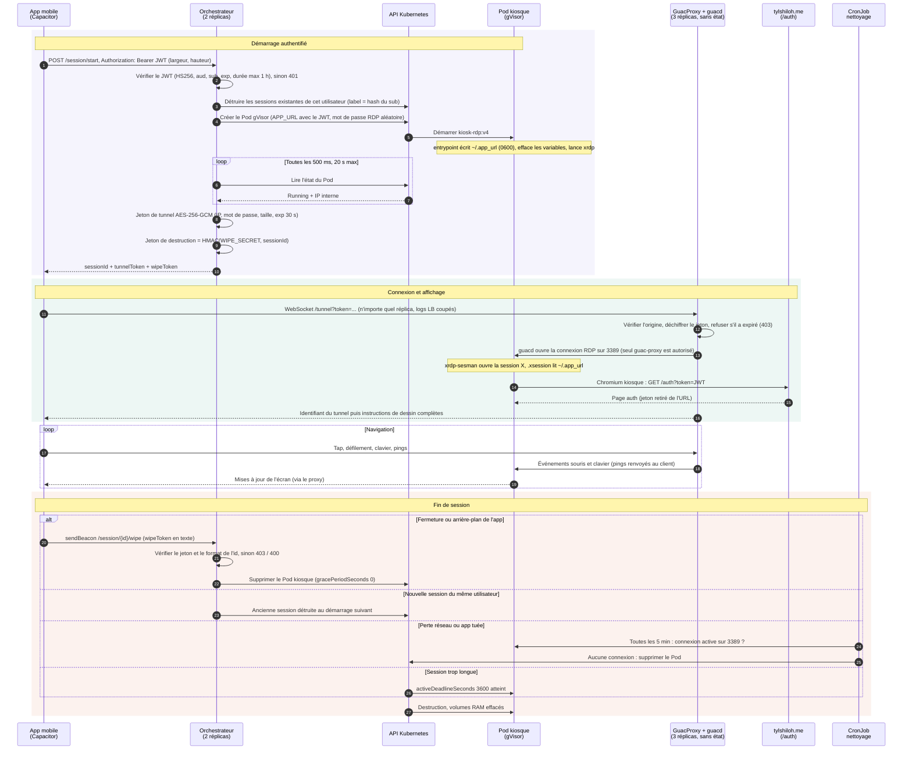

# Cycle de vie d'une session

Diagramme de séquence d'une session de navigateur mobile isolé, de l'ouverture
de l'application jusqu'à la destruction du Pod.

Accès public via l'Ingress GKE (`xmobile.tylshiloh.me`, HTTPS / WSS) :
`/session/*` vers l'orchestrateur, `/tunnel` vers le proxy Guacamole sans état,
toute autre adresse en 404.

## Composants

| Composant | Dossier | Rôle |
|---|---|---|
| App mobile | `mobile-rdp-app/` | Client Capacitor + `guacamole-common-js`, envoie le JWT, ouvre le tunnel |
| Orchestrateur | `Orchestrator/` | Vérifie le JWT, crée et détruit les Pods, émet les jetons de tunnel et de destruction |
| Proxy Guacamole | `GuacProxy/` | WebSocket ↔ guacd, sans état, plusieurs réplicas |
| Kiosque | `Kiosque/` | Image xrdp + openbox + Chromium en mode kiosque |
| Nettoyage et isolation | `Guacamole/` | CronJob des Pods orphelins, NetworkPolicy des sessions |
| Page d'accueil web | `WebApp/` | `/auth` et `404.html` servis par le bucket `tylshiloh.me` |

## Limites connues

- Les jetons (JWT et tunnel) ne sont pas à usage unique : ils restent valables
  jusqu'à leur expiration (tunnel : 30 s). Memorystore pour Valkey permettrait
  de les rendre strictement à usage unique.
- Aucun backend d'identité n'émet encore les JWT : `Orchestrator/tools/make-test-jwt.py`
  sert pour les tests.
- La page `/auth` est statique : elle lit le JWT mais ne le vérifie pas côté serveur.
